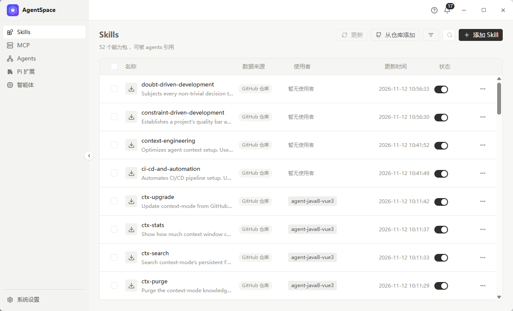

# AgentSpace

[](https://tauri.app)
[](https://vuejs.org)
[](https://www.rust-lang.org)
[](https://pnpm.io)
[](https://learn.microsoft.com/windows/)

**AgentSpace 是一个 AI 工具箱** —— 把智能体、Skills、MCP server、Pi 扩展收在一处管，
再用 `agentspace` 命令行把它们铺到任意项目里跑起来。

```bash
cd D:/OB/your-project
agentspace run my-agent     # Skills / 指令 / MCP 铺到当前目录，拉起 Pi
```

## 功能

| 能力         | 做什么                                                                           |
| ------------ | -------------------------------------------------------------------------------- |
| **Skills**   | 统一看本机 Skill 仓库：来源、谁在用、更新时间、启停开关                          |
| **MCP 管理** | 一个代理地址（`http://127.0.0.1:7801/mcp`）对上所有 agent，上游 server 集中管理  |
| **Agents**   | 探测本机 CLI agent（Claude Code / Codex / Gemini CLI …），能装、能升级、能看版本 |
| **Pi 扩展**  | Pi 自带 / npm / 自定义三类扩展，勾选即用                                         |
| **智能体**   | 把上面挑好的能力打包成一份可复用配置，`agentspace run` 一键落地                  |



> 完整界面截图与逐页操作说明：[应用 README](./apps/AgentCompose/README.md) · [使用指南](./apps/AgentCompose/docs/使用指南.md)

## 技术

| 层         | 选型                                                                       |
| ---------- | -------------------------------------------------------------------------- |
| 桌面端     | Tauri 2 + Vue 3 + TypeScript + Naive UI                                    |
| 桌面端后端 | Rust（skills / agents / extensions / mcp / proxy / history / github 模块） |
| 命令行     | Rust + clap（`agentspace`）                                                |
| MCP 代理   | TypeScript sidecar（对上游是 client，对 agent 是 server）                  |
| 工程化     | pnpm workspace + catalog、turbo、Vitest、ESLint、Prettier、changesets      |

## 仓库结构

| 部件        | 位置                         | 作用                                                     |
| ----------- | ---------------------------- | -------------------------------------------------------- |
| 桌面端      | `apps/AgentCompose`          | Tauri + Vue 3，管理智能体 / Skills / MCP / Pi 扩展       |
| 共享 crate  | `apps/agentspace-core`       | 智能体、Skill、工具箱、代理的落盘逻辑，桌面端与 CLI 共用 |
| 命令行      | `apps/agentspace-cli`        | `agentspace` —— 按智能体定义准备目录并拉起 Pi            |
| MCP sidecar | `packages/agent-compose-mcp` | MCP 代理：对上游是 client，对 agent 是 server            |

## 快速开始

```bash
pnpm install                                    # 装依赖
pnpm --filter @remote/agent-compose dev        # 起桌面端
pnpm build / typecheck / test / lint            # 构建、类型检查、测试、规范
```

## 文档

- [应用 README（产品介绍 + 界面截图）](./apps/AgentCompose/README.md)
- [使用指南（按页面走一遍）](./apps/AgentCompose/docs/使用指南.md)
- [开发指南（技术栈 / 构建 / 测试 / 规范详解）](./docs/开发指南.md)
- [发布说明](./docs/release-notes/)
