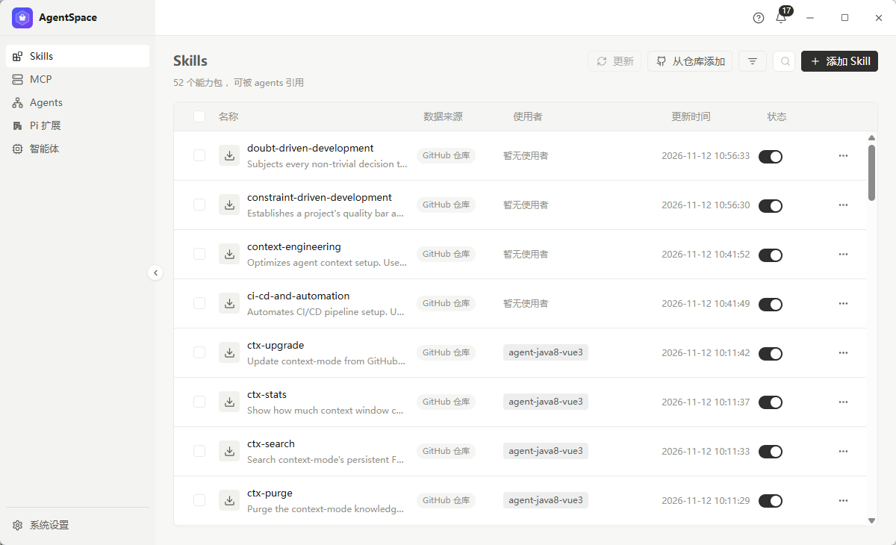
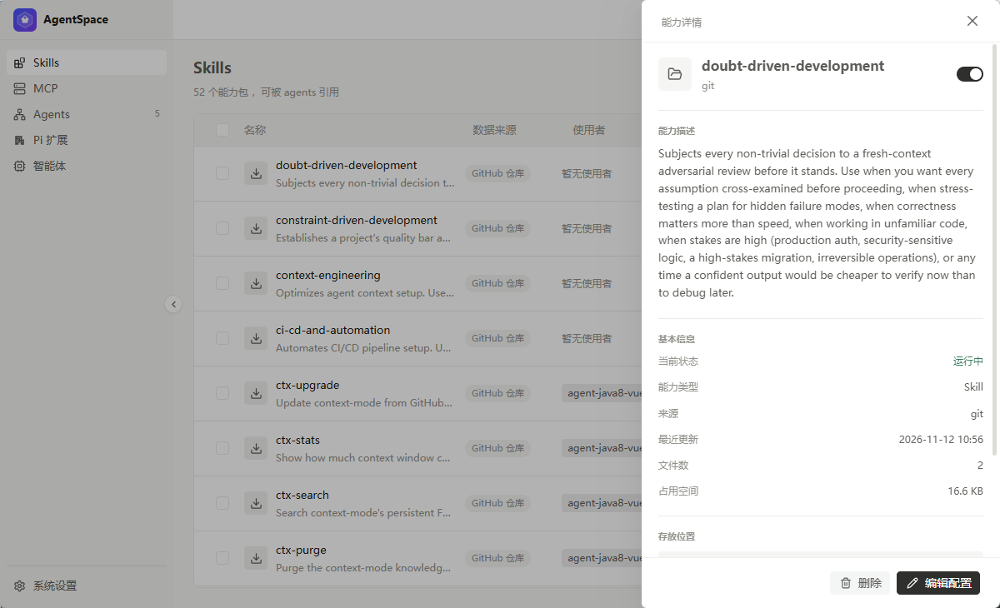
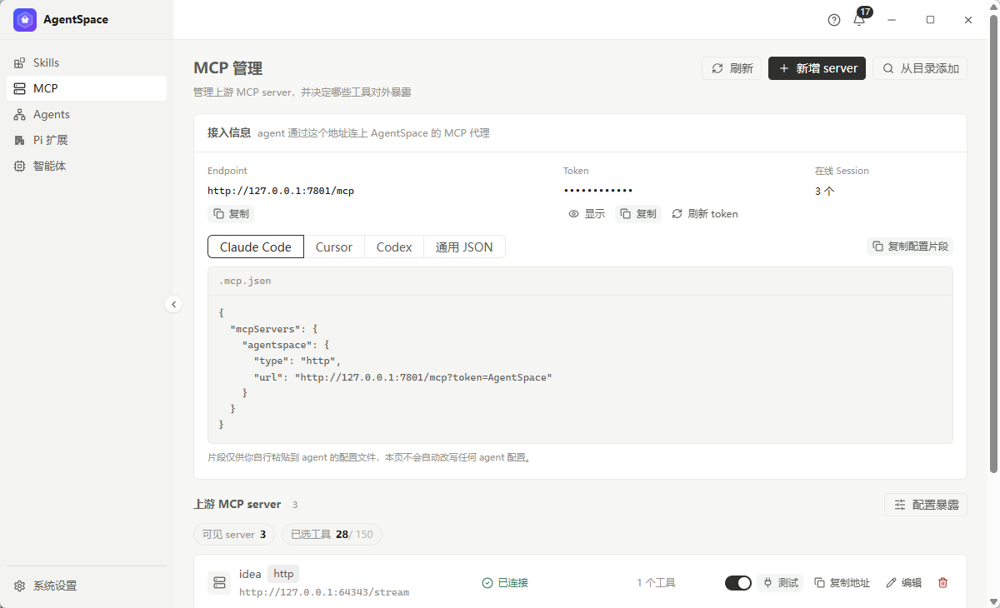
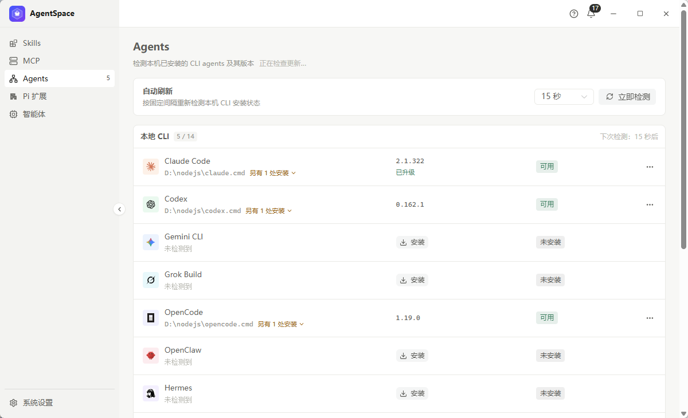
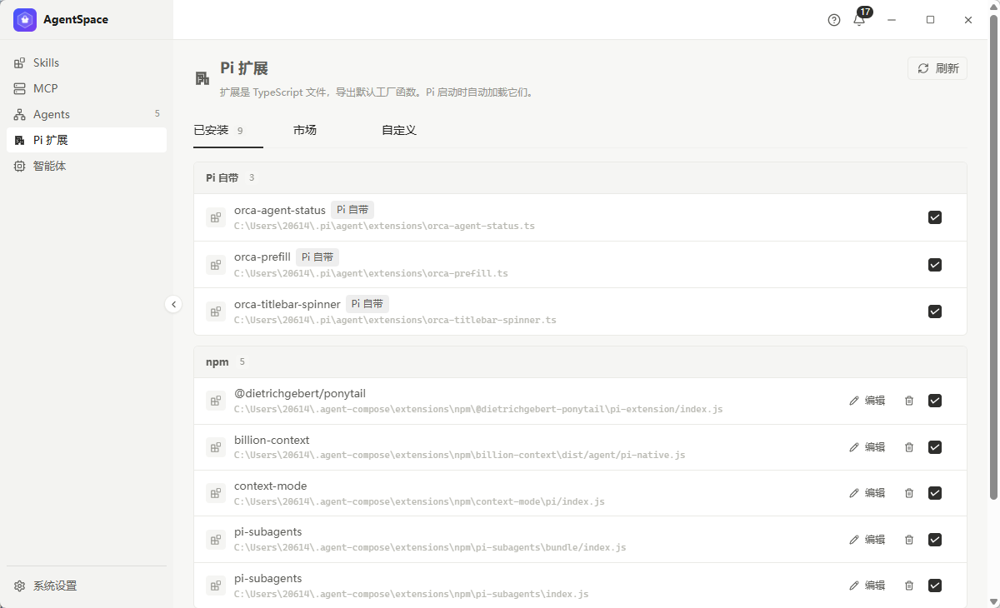
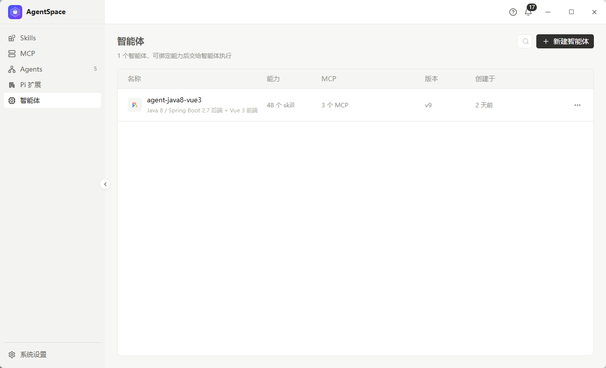
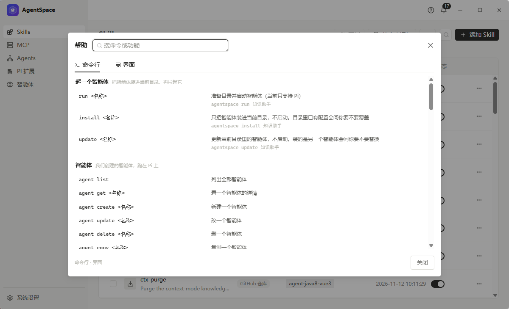
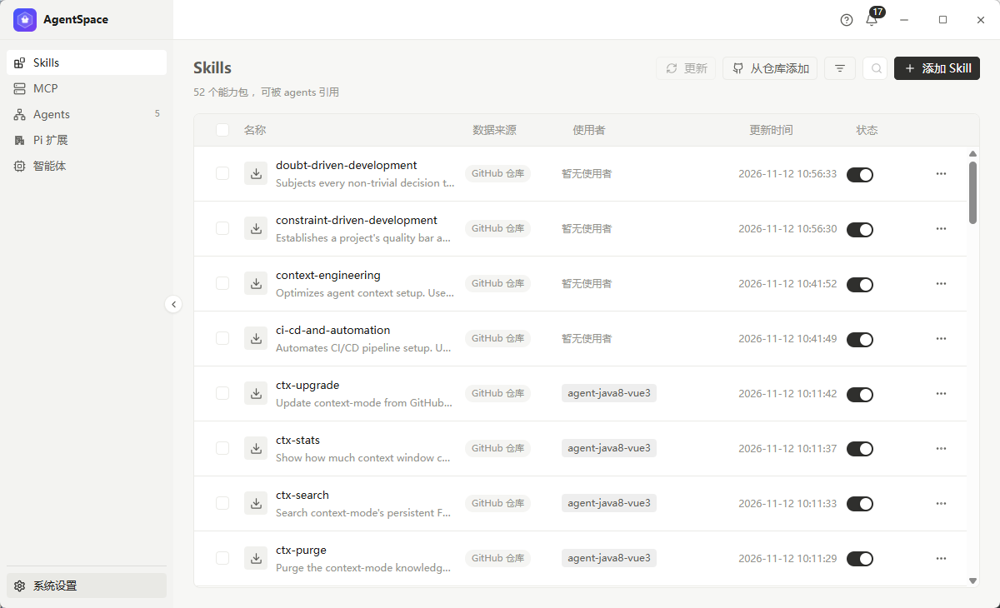

# AgentSpace

[](https://tauri.app)
[](https://vuejs.org)
[](https://www.rust-lang.org)
[](https://www.typescriptlang.org)
[](https://learn.microsoft.com/windows/)

> **AI 工具箱** —— 把智能体、Skills、MCP server、Pi 扩展收在一处管，再用 `agentspace`
> 命令行把它们铺到任意项目里跑起来。

AgentSpace 是一个 Windows 桌面应用（Tauri 2 + Vue 3 + Rust）。它把散落在本机各处的
**AI 能力资产**收进一个界面：能复用的 Skills、能连上游的 MCP server、能直接升级的
本机 CLI agent（Claude Code / Codex / Gemini CLI …）、以及 Pi 运行时加载的扩展。

管理完再用一条命令落地：

```bash
agentspace run my-agent     # 把绑定的 Skills / 指令 / MCP 铺到当前目录，拉起 Pi
```

---

## 目录

- [它解决什么问题](#它解决什么问题)
- [界面一览](#界面一览)
- [核心能力](#核心能力)
- [快速开始](#快速开始)
- [典型使用方案](#典型使用方案)
- [数据放在哪](#数据放在哪)
- [命令行速查](#命令行速查)
- [从源码跑起来](#从源码跑起来)
- [目录结构](#目录结构)
- [常见问题](#常见问题)
- [相关文档](#相关文档)

---

## 它解决什么问题

用 AI 写代码时，真正费时间的往往不是"让模型写一段代码"，而是**把环境配对**：

| 痛点                                                      | AgentSpace 怎么做                                                      |
| --------------------------------------------------------- | ---------------------------------------------------------------------- |
| Skill 装在 `~/.claude/skills`、`~/.pi/skills`… 到处散着装 | 一个 Skills 页统一看：来源、谁在用、更新时间、启停开关                 |
| MCP server 的配置文件要塞进各个 agent 的配置目录          | 一个 MCP 代理对外只暴露一个地址，各 agent 指向它，上游 server 集中管理 |
| 本机装了 5 个 CLI agent，哪个能跑、哪个要升级？           | Agents 页自动探测 PATH 与常见安装目录，能装能升级能看版本              |
| Pi 扩展要手动往 `extensions/` 目录里拷                    | Pi 扩展页按「Pi 自带 / npm / 自定义」分组，勾选即用                    |
| 换项目要重新配一遍 Skills、指令、MCP                      | 智能体 = 一份可复用的配置；`agentspace run <名字>` 一键铺到当前目录    |

一句话：**把"环境"变成"可点两下的配置"，把"配置"变成"一条命令"。**

---

## 界面一览

|                                                                                     |                                                                                               |
| ----------------------------------------------------------------------------------- | --------------------------------------------------------------------------------------------- |
| <br/>**Skills** — 统一管理本机 Skill 仓库          | <br/>**Skill 详情** — 描述、来源、文件数、占用空间 |
| <br/>**MCP 管理** — 一个代理地址 + 上游 server 列表      | <br/>**Agents** — 探测本机 CLI agent 并就地升级              |
| <br/>**Pi 扩展** — Pi 自带 / npm / 自定义分组 | <br/>**智能体** — 可复用配置的一览                       |
| <br/>**帮助中心** — 命令行与界面用法，可搜索       | <br/>**系统设置** — 版本检测、命令行、网络代理           |

---

## 核心能力

### Skills —— 本机 Skill 仓库

- 多个来源：GitHub 仓库、本地目录、手工创建
- 表格里直接看：名称、描述、来源、**哪些智能体在用**、更新时间、启停开关
- 行菜单可更新 / 复制 / 重命名 / 删除；详情抽屉里有描述、文件数、占用空间、存放位置
- 刷新会从 git 源重新拉取；没有可更新来源的会明确跳过而不是静默失败

> 界面细节：左侧栏可收起成图标列（`Ctrl + B`），页面右上角的搜索框默认只露一个
> 放大镜，鼠标移上去才展开成完整输入框。


### MCP 管理 —— 一个代理地址搞定所有上游

AgentSpace 内置 MCP sidecar：对上游是 client，对 agent 是 server。

- 面板顶部直接给出**接入地址**（`http://127.0.0.1:7801/mcp`）与 token
- 一键复制 Claude Code / Cursor / Codex 的配置片段，或通用 JSON
- 上游 server 列表：连接状态、工具数、启停、测试、编辑地址、删除
- 「配置暴露」可以决定哪些工具对 agent 可见（白名单式收敛）
- 所有 agent 只需要指向这一个地址，换上游不用改 agent 配置


### Agents —— 本机 CLI agent 体检与升级

- 自动探测 Claude Code、Codex、Gemini CLI、Grok Build、OpenCode、OpenClaw、Hermes …
- 区分「已安装可用」「未安装」「已安装但跑不起来」，并给出诊断信息
- 支持就地升级：先算升级计划（版本对比 + 变更说明），确认后再执行
- 定时自动刷新（可配间隔），也可「立即检测」


### Pi 扩展 —— 运行时扩展的三种来源

- **Pi 自带**：Pi 运行时自动加载，这里只读展示
- **npm**：从 npm 装扩展（`@owner/pkg`），带编辑与卸载
- **自定义**：本地目录里的扩展文件
- 扩展 = TypeScript 文件，导出默认工厂函数，Pi 启动时自动加载它们


### 智能体 —— 一份可复用的配置

新建智能体分两步：**选运行时**（当前支持 Pi）→ **填配置**。

| 配置项      | 说明                                                        |
| ----------- | ----------------------------------------------------------- |
| 名称 / 描述 | 这个智能体是谁、干什么                                      |
| 指令        | 写进 `AGENTS.md` 的行为准则（做什么、关注什么、要避开什么） |
| SKILLS      | 勾选要带的 Skill                                            |
| MCP         | 勾选要连的 MCP server                                       |
| PI 扩展     | 勾选要加载的工具箱扩展                                      |


### 帮助中心 —— 用不上的功能等于没有

顶栏问号按钮打开帮助中心，两个页签共用一个搜索框：

- **命令行**：全部 `agentspace` 命令逐条说明
- **界面**：按页面讲每个按钮点下去会发生什么


---

## 快速开始

### 装桌面端

到 [Releases](https://github.com/2000cyj/primeval/releases) 下载：

| 产物                            | 说明                         |
| ------------------------------- | ---------------------------- |
| `AgentSpace_*_x64-setup.exe`    | NSIS 安装包，双击一路下一步  |
| `AgentSpace_*_x64_portable.zip` | 便携版，解压即用，不写注册表 |

首次启动会自动把 `agentspace` 命令行装到用户 PATH（Windows 下写 `HKCU\Environment`），
并登记 Pi 信任目录，重开终端就能直接用。

### 用命令行

```bash
agentspace run <智能体名>        # 准备目录并启动智能体
agentspace install <智能体名>    # 只落地配置，不启动
agentspace update <智能体名>     # 覆盖更新已装好的配置
```

---

## 典型使用方案

### 方案一：把一套"Java + Vue 交付"能力复用到每个项目

1. 在 **Skills** 页从 GitHub 仓库添加 `agent-skills`，勾选需要的 Skill
2. 在 **MCP** 页接上 idea / figma 等上游 server，配好工具暴露
3. 在 **智能体** 页新建 `agent-java8-vue3`：描述写清职责，指令写清交付规范，勾选 48 个 Skill、3 个 MCP
4. 以后换项目只要：

   ```bash
   cd D:/OB/new-project
   agentspace run agent-java8-vue3
   ```

   Skills、指令、MCP 全部铺好，Pi 直接开工。

### 方案二：给团队统一 MCP 上游

所有 agent 只认 `http://127.0.0.1:7801/mcp` 一个地址；上游 server 的增删改、
token 刷新、工具暴露都在 **MCP 管理**页做，改一次全员生效。

### 方案三：体检本机 AI 工具链

**Agents** 页点「立即检测」，一次性看清：哪些 agent 装了、版本多少、还能不能跑、
有没有新版。Windows 下执行外部命令不会闪黑窗口。

### 方案四：给智能体加自定义扩展

写一个 TypeScript 扩展文件放进「自定义」分组，在智能体配置里勾上，
Pi 启动时自动加载。

---

## 数据放在哪

一切都落在 `~/.agent-compose/` 下，桌面端与命令行共用同一份：

```text
~/.agent-compose/
├── agents/<id>/             智能体定义（agent.json + AGENTS.md）
├── skills/<目录名>/          Skill 仓库
├── extensions/npm/<名>/      npm 扩展（连同它自己的 node_modules）
├── extensions/custom/<名>/   自定义扩展
├── mcp/                     MCP 代理运行时目录
├── git/<host>/<owner>/<仓库>  git 源的本地克隆
└── bin/                     随应用分发的可执行文件（agentspace / sidecar）
```

---

## 命令行速查

| 命令                                                  | 作用                                  |
| ----------------------------------------------------- | ------------------------------------- |
| `agentspace run <名称>`                               | 准备目录并启动智能体（当前只支持 Pi） |
| `agentspace install <名称>`                           | 只装智能体到当前目录，不启动          |
| `agentspace update <名称>`                            | 更新当前目录里的智能体                |
| `agentspace agent list/get/create/update/delete/copy` | 智能体增删改查                        |
| `agentspace skill …`                                  | Skill 仓库操作                        |
| `agentspace mcp …`                                    | MCP server 操作                       |
| `agentspace extension …`                              | Pi 扩展操作                           |
| `agentspace tool …`                                   | 本机 CLI 工具箱操作                   |
| `agentspace proxy …`                                  | 全局出站代理                          |

所有命令支持 `--json`，输出给 agent 直接解析。

---

## 从源码跑起来

前置：Node ≥ 22.18.0、pnpm 10.18.1、Rust（windows-gnu 或 msvc 均可）。

```bash
pnpm install                                   # 装依赖并初始化 husky
pnpm --filter @remote/agent-compose dev        # 起 Tauri 桌面端（vite 5176 + 原生窗口）
pnpm --filter @remote/agent-compose dev:web    # 只起渲染层（浏览器里看，不带原生壳）
pnpm --filter @remote/agent-compose typecheck  # vue-tsc
pnpm --filter @remote/agent-compose test       # vitest
pnpm --filter @remote/agent-compose build      # 打包桌面端
```

> Windows 上 `pnpm dev` 走 `scripts/tauri.mjs`：它会准备 GNU 工具链的
> `dlltool` / 链接器（rustup 自带的 GNU 工具链在本机 spawn 不了自己的
> `dlltool.exe`），并先跑一次 2 秒探针编译挑出可用的 `rustc` 参数。

---

## 目录结构

```text
apps/AgentCompose/
├── src/                     Vue 3 渲染层
│   ├── App.vue              外壳：侧边栏 + 顶栏 + 视图路由（hash）
│   ├── components/          顶栏、侧边栏、窗口按钮、各类弹窗与抽屉
│   ├── views/               Skills / MCP / Agents / Pi 扩展 / 智能体 / 设置
│   ├── composables/         通知、CLI 操作、窗口外壳等组合式逻辑
│   ├── api/                 Tauri command 的 TS 封装
│   └── style.css            设计令牌（无彩石墨配色）与全局 reset
├── src-tauri/               Rust 后端
│   ├── src/                 skills / agents / extensions / mcp / proxy / history / github
│   ├── capabilities/        权限清单
│   └── tauri.conf.json      窗口、bundle、CSP
├── scripts/                 build-cli / build-sidecar / tauri 启动器
└── docs/                    使用指南与界面截图
```

---

## 常见问题

**Q：窗口没有系统标题栏了？**
Windows 上系统标题栏被关掉了，改由应用自己画（顶栏即标题栏）——
这样窗口边框和界面是一体的，不会出现"外面一条系统栏、里面一条应用栏"。
拖顶栏空白处移动窗口，双击顶栏最大化，拖边缘缩放。

**Q：`agentspace` 命令找不到？**
桌面端会把命令行装到用户 PATH（`HKCU\Environment`）。已开的终端不会自动刷新，
重开一个终端即可。

**Q：MCP 面板里的地址端口能改吗？**
端口由 sidecar 固定（7801），换端口会让已配置的 agent 全部失联。

**Q：数据能同步到别的机器吗？**
`~/.agent-compose/` 整个目录拷过去即可；git 源的 Skill 会在刷新时重新拉取。

---

## 相关文档

- [使用指南（按页面走一遍）](./docs/使用指南.md)
- [仓库总览（monorepo 结构与工具链）](../../README.md)
- [发布说明](../../docs/release-notes/)
