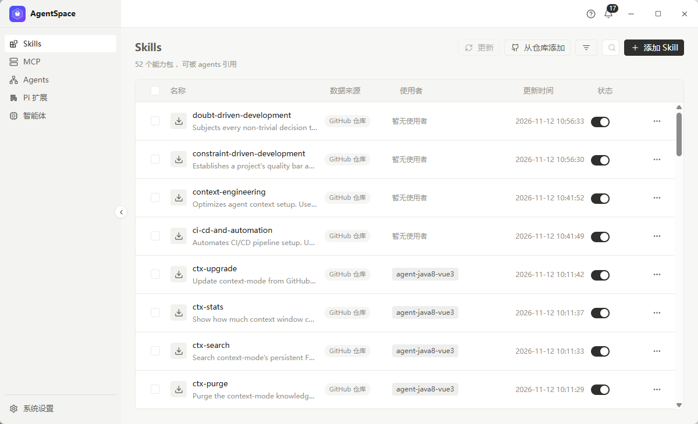
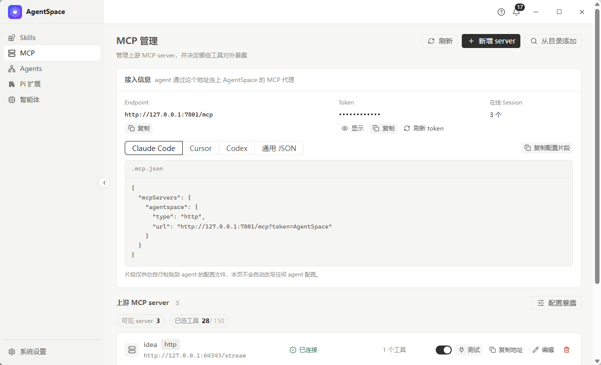
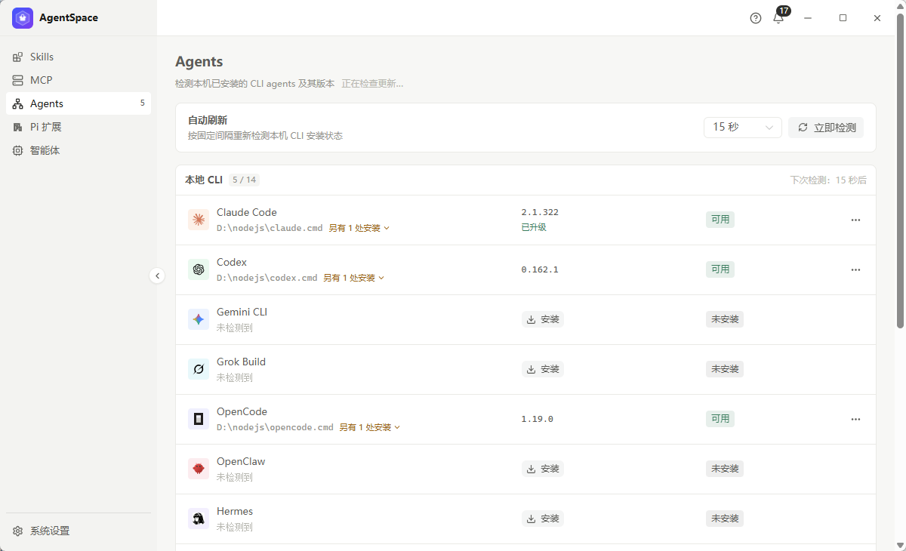
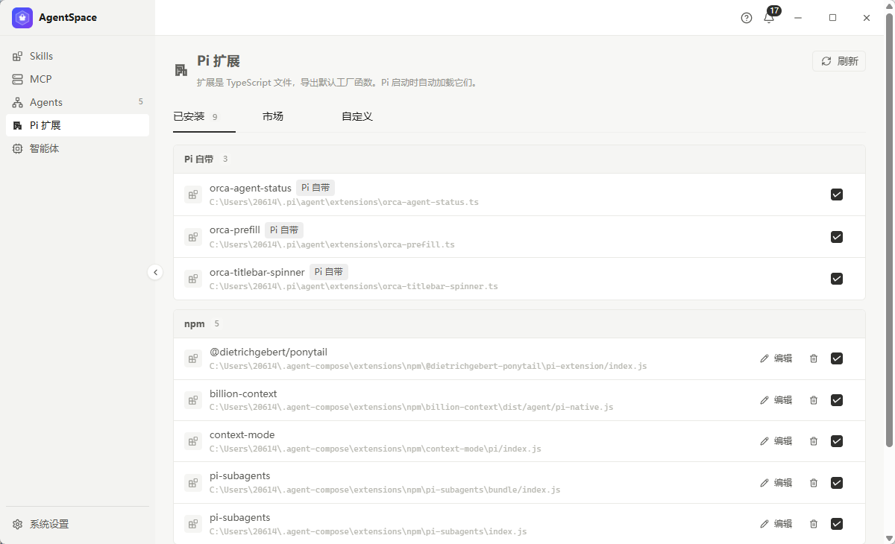
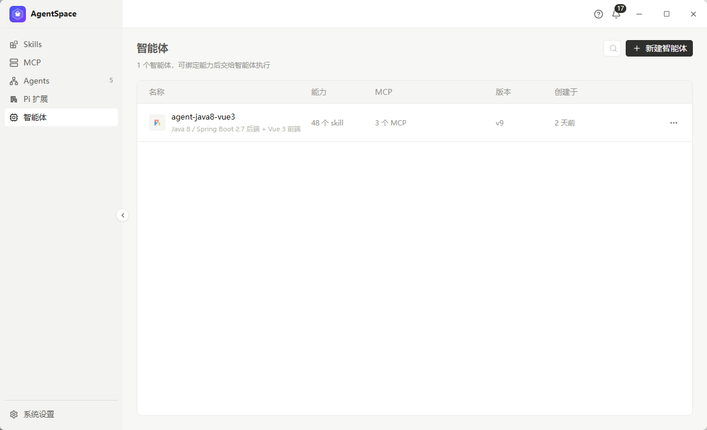
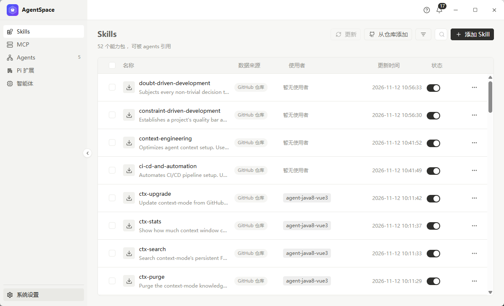

# AgentSpace 使用指南

> 按页面走一遍：每个页面有什么、每个按钮点下去会发生什么、常见任务怎么配方。
> 顶栏问号（帮助中心）里有同一份内容的可搜索版本。



---

## 目录

- [五分钟上手](#五分钟上手)
- [界面结构](#界面结构)
- [Skills](#skills)
- [MCP 管理](#mcp-管理)
- [Agents](#agents)
- [Pi 扩展](#pi-扩展)
- [智能体](#智能体)
- [系统设置](#系统设置)
- [命令行配合](#命令行配合)
- [配方速查](#配方速查)
- [排错](#排错)

---

## 五分钟上手

第一次打开，按这个顺序走一遍：

1. **Agents 页 → 「立即检测」**
   看清本机装了哪些 CLI agent（Claude Code / Codex / Gemini CLI …）、版本多少、能不能跑。
   缺什么就点「安装」，有新版就点「升级」。
2. **Skills 页 → 「添加 Skill」或「从仓库添加」**
   把常用的 Skill 收进来（GitHub 仓库 / 本地目录 / 手工建）。
3. **MCP 页 → 「新增 server」**
   接上要用的上游 MCP server，顺手在「配置暴露」里决定哪些工具对 agent 可见。
4. **Pi 扩展页**
   确认要用的扩展已安装；需要自定义行为就在「自定义」里新建。
5. **智能体页 → 「新建智能体」**
   把上面挑好的能力打包成一个智能体：名称、描述、指令、勾选 Skills / MCP / 扩展。
6. **换到项目目录，敲一条命令**

   ```bash
   cd D:/OB/your-project
   agentspace run <智能体名>
   ```

---

## 界面结构

```text
┌────────────────┬──────────────────────────────────────────────┐
│ 品牌行（拖窗口）│ 顶栏：帮助 ? · 通知铃铛 · 窗口按钮 − □ ✕      │
├────────────────┼──────────────────────────────────────────────┤
│ Skills         │                                              │
│ MCP            │              页面区（当前页面的内容）        │
│ Agents         │                                              │
│ Pi 扩展        │                                              │
│ 智能体          │                                              │
│ ─────────────  │                                              │
│ 系统设置        │                                              │
└────────────────┴──────────────────────────────────────────────┘
```

- **左侧栏**：切页面。底部「系统设置」单独一栏。
- **顶栏**：帮助中心、通知（升级/安装的进度都走这里）、窗口按钮。
  Windows 上没有系统标题栏，这一行**就是**标题栏：拖空白处移动窗口，双击最大化。
- **页面区**：每页左上角是标题 + 一句话说明，右上角是该页的操作按钮。

### 收起 / 展开侧边栏

- 侧边栏右边缝的**中间**有个圆形按钮（`‹` / `›`），一半在侧栏内、一半在主区，点一下就收起 / 展开。
- 收起后侧栏只剩图标列（56px），logo 居中，**悬停菜单项会弹出名字**（Tooltip，弹在侧栏右侧）。
- `Ctrl + B` 也能切换（跟 VS Code 一致）。
- 状态记在本地（localStorage），下次打开还是上次的样子。

### 搜索框：默认只露一个放大镜

页面右上角的搜索框平时**只显示一个放大镜图标**，不占地方；
鼠标移上去或点进去才展开成完整输入框（宽度 0.18s 过渡，不会跳）。

---

## Skills


一个 Skill 就是一个带 `SKILL.md` 的目录。Skills 页是本机 Skill 仓库的总览。

### 页面上的东西

| 位置     | 含义                                             |
| -------- | ------------------------------------------------ |
| 名称     | Skill 名 + 描述（截断显示，鼠标悬停看全文）      |
| 数据来源 | `GitHub 仓库` / `本地目录` / `手工创建`          |
| 使用者   | 哪些智能体引用了它（没人用会显示「暂无使用者」） |
| 更新时间 | 最近一次同步时间                                 |
| 状态     | 开关：关掉不会删文件，只是不再被引用             |

### 按钮

| 按钮             | 作用                                                               |
| ---------------- | ------------------------------------------------------------------ |
| 更新             | 勾选若干 Skill 后批量从 git 源重新拉取；没有可更新来源的会明确跳过 |
| 从仓库添加       | 从以前导入过的 GitHub 仓库里再挑几个 Skill 进来                    |
| 筛选（漏斗图标） | 按来源 / 状态 / 使用者过滤                                         |
| 搜索             | 按名称或描述过滤（默认只有放大镜图标，鼠标移上去才展开）           |
| 添加 Skill       | 手工创建一个 Skill（名称 + 描述 + 正文）                           |

### 行菜单（每行右侧 `…`）

- **查看详情** → 右侧抽屉：描述、当前状态、能力类型、来源、最近更新、文件数、占用空间、存放位置
- **编辑** → 改名称 / 描述 / 正文
- **创建副本** → 复制一份改
- **删除** → 二次确认后删除

### 常见问题

**Q：更新后内容没变？**
只有 git 来源的 Skill 才有"更新"；本地目录和手工创建的会以本地为准。

---

## MCP 管理



AgentSpace 内置一个 MCP 代理（sidecar）：**对上游是 client，对 agent 是 server**。
所有 agent 只认这一个地址，上游 server 增删改在应用里做。

### 接入信息（页面顶部）

- **Endpoint**：`http://127.0.0.1:7801/mcp`
- **Token**：默认 `AgentSpace`，可刷新
- **在线 Session**：当前有多少个 agent 连着

四个页签分别给出 **Claude Code / Cursor / Codex / 通用 JSON** 的配置片段，
点「复制配置片段」直接拿走。片段里的路径是**给你粘贴到 agent 的配置里**的，
应用不会替你改 agent 配置。

### 上游 MCP server

列表里每个 server 显示：名称、地址、连接状态（已连接 / 断开 / 报错）、工具数、启用开关，
以及四个操作：**测试**（探活 + 列出工具）、**复制地址**、**编辑**、**删除**。

### 配置暴露

决定哪些上游 server、哪些工具对 agent 可见（默认全开）。收敛暴露面时用：
只勾 agent 真正要用的工具，减少上下文占用，也减少误触。

### 新增 server

- **新增 server**：手填名称、地址、传输方式、鉴权
- **从目录添加**：扫本机已有的 MCP 配置文件目录批量导入

---

## Agents



这一页体检本机的 **CLI agent**（就是能直接跑代码的 AI 命令行工具），
顺便当升级器用。

### 自动刷新

- 间隔可选（默认 15 秒），按固定间隔重新检测本机安装状态
- 「立即检测」手动触发一次

### 本地 CLI 列表

每个 agent 一行：

| 列          | 含义                                                                       |
| ----------- | -------------------------------------------------------------------------- |
| 名称 + 路径 | 命中的可执行文件路径；多个安装位置时展开成列表，标「默认」的是 PATH 里那个 |
| 版本        | 跑 `--version` 解析出来的                                                  |
| 状态        | `可用` / `未安装` / `已安装但跑不起来`（附带诊断信息）                     |

行菜单里可以**安装**、**升级**。升级会先给一个**升级计划**（目标版本、变更说明），
确认后才真正执行；执行过程中的进度会推到顶栏通知铃铛里。

---

## Pi 扩展



Pi 扩展是 TypeScript 文件，导出默认工厂函数，**Pi 启动时自动加载**。

三个页签：

| 页签   | 内容                                                                                       |
| ------ | ------------------------------------------------------------------------------------------ |
| 已安装 | 按来源分组：`Pi 自带`（运行时自动加载，只读）/ `npm`（`@owner/pkg`）/ `自定义`（本地文件） |
| 市场   | 搜索 npm 上的扩展并安装                                                                    |
| 自定义 | 新建 / 编辑本地扩展文件                                                                    |

npm 扩展那一行可以**编辑**（改扩展配置）和**删除**。
「自定义」里可以新建扩展文件，保存后即可在智能体配置里勾选。

---

## 智能体



智能体 = 一份可复用的配置（身份 + 指令 + Skills + MCP + 扩展）。

### 新建（两步向导）

**第 1 步 · 选择运行时**
选这个智能体在哪里跑（当前只支持 Pi）。页面里直接给出安装命令与复制按钮。

**第 2 步 · 配置**

| 字段    | 说明                                                                 |
| ------- | -------------------------------------------------------------------- |
| 名称    | 智能体标识，`agentspace run <名称>` 用的就是它                       |
| 描述    | 一句话说清它负责什么、擅长什么（≤ 255 字）                           |
| 指令    | 行为准则：做什么、关注什么、要避开什么。会写进落地目录的 `AGENTS.md` |
| SKILLS  | 勾选要带的 Skill（点开选择器修改）                                   |
| MCP     | 勾选要连的 MCP server                                                |
| PI 扩展 | 勾选要加载的工具箱扩展                                               |

### 列表与行菜单

列表显示名称、能力（多少 skill / 多少 MCP）、版本、创建时间。行菜单：

- **复制** → 复制智能体
- **复制启动命令** → 直接拿到 `agentspace run <名称>` 这条命令
- **删除** → 二次确认

点名称进入编辑页，可以改配置；也可以在编辑页点「运行」直接起一次。

---

## 系统设置



### 应用信息与版本

- 当前版本号
- **检查最新版本**：按钮三态 —— 未检查（"检查最新版本"）/ 有新版（"更新到 X.Y.Z"，
  旁边给出版本号、发布日期与发布说明）/ 已是最新（按钮禁用）
- 点「更新到」会打开安装包下载；拿不到直链就打开发布页

### 命令行

- `agentspace` 命令行的安装位置与安装状态
- 一键重装 / 复制安装命令
- 说明：`agentspace run <名称>` 会把绑定的 Skills、指令、MCP 落到当前目录，然后用 Pi 打开

### 网络

全局出站代理设置（供各 CLI agent 复用），密码可隐藏显示。

---

## 命令行配合

桌面端管"资产"，命令行管"落地"。两者共用 `~/.agent-compose/` 下的同一份数据。

```bash
agentspace run <名称>          # 准备目录并启动智能体
agentspace install <名称>      # 只落地配置，不启动
agentspace update <名称>       # 覆盖更新已装好的配置

agentspace agent list          # 列出全部智能体
agentspace skill list          # Skill 仓库
agentspace mcp list            # MCP server
agentspace extension list      # Pi 扩展
agentspace tool list           # 本机 CLI 工具箱
agentspace proxy show          # 出站代理
```

`install` / `update` 的行为：

- `install` 在空目录直接装；目录里已有落地物会先问要不要覆盖
- `update` 装的智能体名字对不上，会问是"替换成新的"还是"先装一个" —— 认错名字就覆盖很容易后悔

所有命令加 `--json` 输出机器可读格式。

---

## 配方速查

| 目标                     | 步骤                                                              |
| ------------------------ | ----------------------------------------------------------------- |
| 让新项目继承一套既有能力 | `agentspace run <智能体名>`                                       |
| 换一批 Skill 试试        | Skills 页勾选 → 更新 → 智能体配置里改勾选                         |
| 只给 agent 三个工具      | MCP 页 → 配置暴露 → 只勾这三个                                    |
| 统一团队 MCP 上游        | MCP 页新增 server → 各 agent 配置指向 `http://127.0.0.1:7801/mcp` |
| 体检本机工具链           | Agents 页 → 立即检测                                              |
| 给智能体加行为钩子       | Pi 扩展 → 自定义 → 写扩展 → 智能体配置里勾上                      |
| 看升级在不在跑           | 顶栏铃铛                                                          |

---

## 排错

| 现象                    | 处理                                                                  |
| ----------------------- | --------------------------------------------------------------------- |
| `agentspace` 提示找不到 | 桌面端会自动装到用户 PATH，**重开一个终端**（老终端不刷新环境变量）   |
| MCP server 一直"断开"   | 先点「测试」看错误信息；多为地址写错、鉴权过期或上游没起              |
| agent 连不上 MCP        | 确认 sidecar 在跑（MCP 页顶部 Endpoint 可访问）、token 没被刷新掉     |
| Skill 更新没反应        | 只有 git 来源可更新；本地目录的以本地文件为准                         |
| Windows 弹黑窗口        | 已修（v1.0.1）：所有外部命令统一封装，Windows 下带 `CREATE_NO_WINDOW` |
| 窗口标题栏不见了        | Windows 上系统标题栏被替换成应用内标题栏，属预期；拖顶栏移动窗口      |
